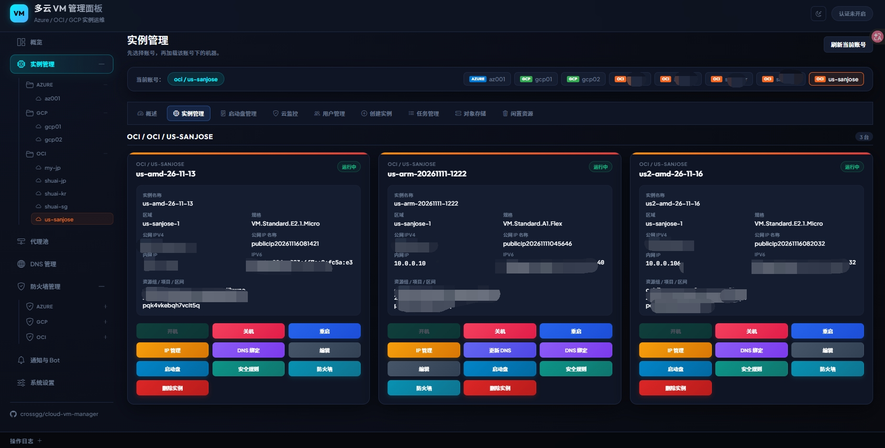

# Cloud VM Manager



轻量级多云虚拟机管理面板，支持 **Azure**、**GCP**、**OCI (Oracle Cloud)** 实例运维、IPv4/IPv6 与 DNS 联动、防火墙规则管理、代理池、OCI 控制台扩展（账户概览、抢购任务、IAM 与对象存储）等功能。

> **说明**：云账号、密钥文件上传、代理池、Cloudflare DNS、登录认证及在线更新现已**全部支持在 WebUI 中可视化配置与热重载**，无需再手写配置文件即可开箱使用。

## 文档索引

- 📡 **HTTP API 文档**：[docs/api.md](docs/api.md)
- 📝 **手动配置文件说明**：[docs/manual-config.md](docs/manual-config.md)（完整 INI 字段细节见 [CONFIGURATION.md](CONFIGURATION.md)）
- 🔑 **云厂商凭据获取指南**：[Azure 指南](docs/azure-config-guide.md) · [OCI 指南](docs/oci-config-guide.md) · [GCP 指南](docs/gcp-config-guide.md)
- 🔄 **在线更新与发布说明**：[UPDATE.md](UPDATE.md)
- 📋 **版本更新日志**：[CHANGELOG.md](CHANGELOG.md)

---

## 本地运行

### 从源码运行

需要 Go 1.22+：

```bash
go mod tidy
go run .
```

### 使用预编译二进制运行

从 [GitHub Releases](https://github.com/crossgg/cloud-vm-manager/releases) 下载对应系统与架构的压缩包并解压运行：

```bash
./cloud-vm-manager
```

启动后默认监听端口 `3000`，浏览器访问：

```text
http://localhost:3000
```

首次启动后，可直接进入左侧 **「系统设置」→「云账号与配置管理」** 添加云账号并上传密钥文件，或在启动前按 [手动配置文件说明](docs/manual-config.md) 预置 `config/config.conf`。

---

## Docker 部署

准备持久化目录：

```bash
mkdir -p config/keys runtime
```

- `./config`：存放配置文件（`config.conf`、`dns.conf`、`proxy.conf`）、缓存文件与 `keys/` 密钥文件；手动配置密钥路径时请写容器内路径 `/app/config/keys/xxx.pem`。
- `./runtime`：保存通过 WebUI「系统设置 → 程序更新」下载的新版二进制文件与前端资源，容器重建或重启后仍会自动优先运行该版本。

### 方式一：Docker Compose（推荐）

使用仓库自带的 [docker-compose.yaml](docker-compose.yaml)：

```bash
docker compose up -d
```

### 方式二：Docker Run（官方镜像）

```bash
docker pull ghcr.io/crossgg/cloud-vm-manager:latest

docker run -d \
  --name cloud-vm-manager \
  -p 3000:3000 \
  -v $(pwd)/config:/app/config \
  -v $(pwd)/runtime:/app/runtime \
  --restart unless-stopped \
  ghcr.io/crossgg/cloud-vm-manager:latest
```

### 方式三：Docker 本地自构建

```bash
docker build -t cloud-vm-manager:local .

docker run -d \
  --name cloud-vm-manager \
  -p 3000:3000 \
  -v $(pwd)/config:/app/config \
  -v $(pwd)/runtime:/app/runtime \
  --restart unless-stopped \
  cloud-vm-manager:local
```

---

## 反向代理部署（宝塔 / Nginx + HTTPS）

如需开放公网访问，强烈建议：
1. 在 WebUI **「系统设置 → 登录认证」**（或手动修改配置）开启登录认证，设置强密码，并在通过 HTTPS 访问时勾选 **HTTPS Cookie**。
2. 在反向代理中添加站点并配置 SSL 证书，反代目标填写 `http://127.0.0.1:3000`。
3. 确保转发以下请求头（特别是 `Host` 与 `X-Forwarded-Proto`，否则开启认证后登录及修改类 POST 请求会因同源校验失败而被拒绝）：

```nginx
location / {
    proxy_pass http://127.0.0.1:3000;
    proxy_set_header Host $host;
    proxy_set_header X-Real-IP $remote_addr;
    proxy_set_header X-Forwarded-For $proxy_add_x_forwarded_for;
    proxy_set_header X-Forwarded-Proto $scheme;
    proxy_set_header Upgrade $http_upgrade;
    proxy_set_header Connection "upgrade";
}
```

---

## License

MIT
